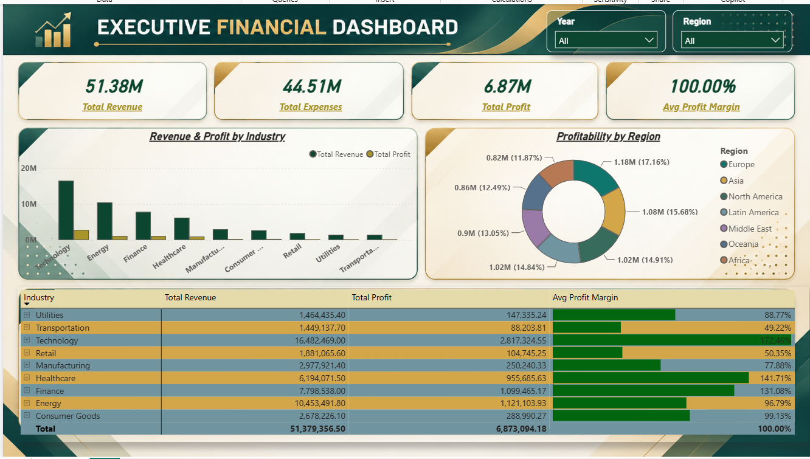
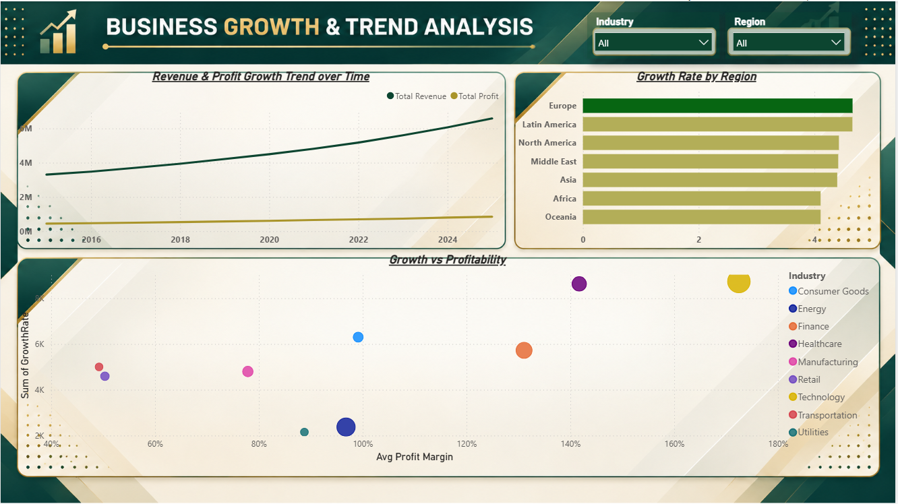

# 📊 Business Performance & Profitability Analysis
**End-to-End Data Analytics Project | Python • Power BI • DAX**  
**Prepared by:** Sonu Kumar Thakur  
**Role:** Data Analyst Intern @ Securozen  
**Project Domain:** Financial Analytics & Corporate Strategy  

## 🚀 Project Overview
This project provides a comprehensive financial and operational performance analysis using historical multi-year corporate data ($51.38M Total Revenue analyzed across 11 years). 

By leveraging Python for data cleaning, financial metric calculations, and feature engineering alongside Power BI for interactive visualization, this project identifies high-margin growth drivers, pinpoints underperforming industry sectors and geographic regions, and delivers data-driven strategies to improve business profitability.

## 🛠️ Tech Stack
| Technology | Purpose |
|---|---|
| Python (Pandas, NumPy) | Data cleaning, preprocessing, missing value handling, and financial metric calculations |
| Microsoft Power BI | Interactive 2-page executive dashboard development and data modeling |
| DAX | Custom measures for financial KPIs (Total Revenue, Total Expenses, Net Profit, Profit Margin) |
| Excel / CSV | Data storage and tabular exports |

## 📁 Repository Structure
```text
Business-Performance-Analysis/
│
├── Data/
│   ├── company_esg_financial_dataset.csv
│   └── Cleaned_Business_Performance.csv
│
├── Scripts/
│   └── Cleaning.ipynb
│
├── Dashboard/
│   ├── ESG_Business_Performance.pbix
│   ├── page1.png
│   └── page2.png
│
└── Report/
    └── Executive_Business_Performance_Profitability_Report.pdf

```
## 📈 Dashboard Preview

### Page 1 — Executive Financial Performance & Profitability
Provides a high-level overview of core financial KPIs ($51.38M Revenue, $6.87M Profit, 13.38% Margin), regional profit distribution, industry-wise revenue vs profit comparisons, and an interactive conditional matrix targeting underperforming segments.



### Page 2 — Business Growth & Trend Analysis
Deep dives into multi-year revenue and profit trends (2015–2025), average annual growth rates (4.83%), regional growth rankings, and a scatter plot identifying high-growth vs high-profit industry outliers.



## 💡 Key Findings
- **Technology Leads Profitability:** The Technology sector is the strongest profit driver ($2.82M profit at 17.09% profit margin), followed by Healthcare (15.43%) and Finance (14.10%).
- **Retail & Transportation Underperformance:** Retail (5.57% margin) and Transportation (6.09% margin) exhibit squeezed margins due to excessive operational expense ratios (~94% of revenue).
- **Regional Margin Variance:** Asia (15.41% margin) and North America (14.17% margin) generate the highest margins, whereas Oceania (11.75%) and Latin America (11.95%) underperform despite high sales volumes.
- **Consistent Revenue Expansion:** Top-line revenue expanded steadily from $3.31M in 2015 to $6.58M in 2025 (~4.8% YoY growth).
- **Margin Pressure:** While revenue nearly doubled over 11 years, overall profit margins declined slightly from 13.44% to 12.89% due to rising operational costs.

## 🎯 Strategic Recommendations
- **Restructure High-Cost Industries:** Conduct a line-item audit of operational expenses in Retail and Transportation to reduce expense ratios below 85%.
- **Capital Allocation to Top Performers:** Reallocate resources toward Technology and Healthcare sectors to capitalize on higher profit margins.
- **Geographic Cost Optimization:** Re-evaluate logistics, vendor contracts, and tariff structures in Oceania and Latin America.
- **Strict Expense Controls:** Cap non-essential operational expenditure growth at 3% annually to ensure bottom-line profit growth outpaces revenue growth.
- **ESG Capital Efficiency:** Utilize high ESG and energy-efficiency metrics to negotiate reduced debt financing rates, directly cutting corporate interest expenses.

## ▶️ How to Explore the Project
1. Clone this repository to your local machine.
2. Inspect the raw dataset `company_esg_financial_dataset.csv` and cleaned dataset `Cleaned_Business_Performance.csv` in the `Data/` directory.
3. Open `Cleaning.ipynb` in the `Scripts/` folder to view the Python data cleaning and financial calculation workflow.
4. Open `ESG_Business_Performance.pbix` in the `Dashboard/` folder using Microsoft Power BI Desktop to interact with the visualizations.
5. Read `Executive_Business_Performance_Profitability_Report.pdf` in the `Report/` folder for the complete management report and strategic guidance.
